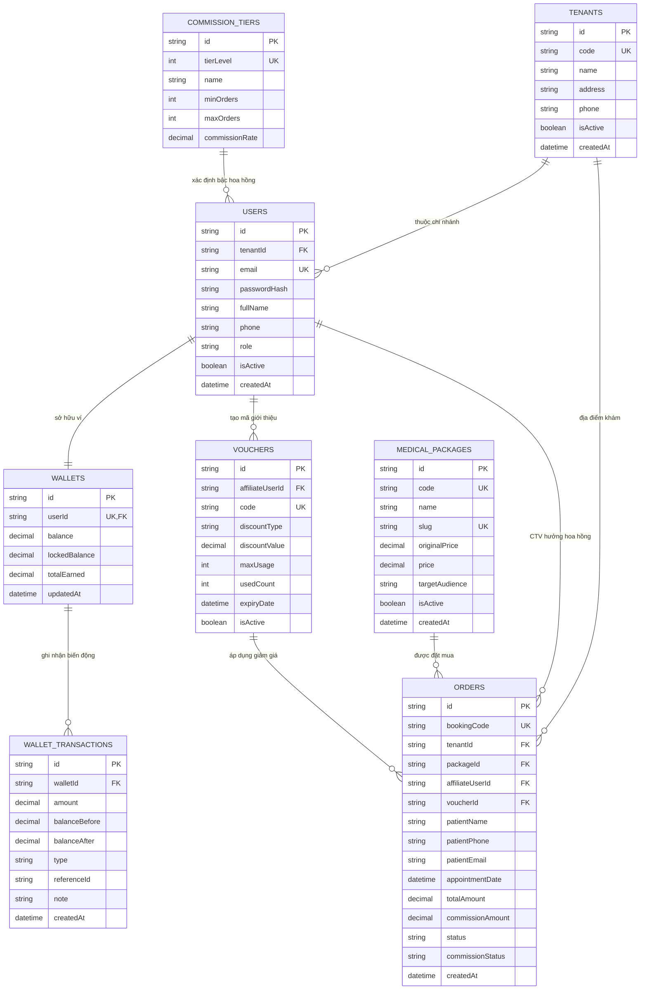

# 📗 DOC-02: THIẾT KẾ CƠ SỞ DỮ LIỆU & QUY CHUẨN TOÀN VẸN TÀI CHÍNH

> **Dự án:** MedAffiliate SaaS Platform  
> **Hệ quản trị CSDL:** MySQL 8.0 (InnoDB Engine)  
> **ORM ánh xạ:** Prisma ORM 5.x / 6.x  

---

## 1. SƠ ĐỒ THỰC THỂ LIÊN KẾT (MERMAID ER DIAGRAM)

Dưới đây là sơ đồ quan hệ 8 bảng dữ liệu cốt lõi của hệ thống được vẽ bằng Mermaid:

---

## 2. ĐẶC TẢ CHI TIẾT 8 BẢNG CƠ SỞ DỮ LIỆU

### 1. Bảng `tenants` (Chi nhánh phòng khám)
*Mục đích:* Quản lý các cơ sở khám chữa bệnh trực thuộc chuỗi (Long Xuyên, Châu Đốc...).

| Tên Cột | Kiểu Dữ liệu | Ràng buộc | Giải thích Nghiệp vụ |
| :--- | :--- | :--- | :--- |
| `id` | `VARCHAR(36)` | `PRIMARY KEY` | Khóa chính sinh dạng UUIDv4 hoặc CUID. |
| `code` | `VARCHAR(20)` | `UNIQUE, NOT NULL` | Mã viết tắt của cơ sở: `LX` (Long Xuyên), `CD` (Châu Đốc). |
| `name` | `VARCHAR(255)` | `NOT NULL` | Tên đầy đủ của phòng khám. |
| `address` | `VARCHAR(500)` | `NOT NULL` | Địa chỉ thực tế để chỉ đường cho bệnh nhân. |
| `phone` | `VARCHAR(20)` | `NOT NULL` | Số điện thoại hotline tiếp nhận của chi nhánh. |
| `is_active` | `BOOLEAN` | `DEFAULT TRUE` | Trạng thái phòng khám đang mở cửa hay tạm ngưng. |
| `created_at` | `DATETIME(3)` | `DEFAULT NOW()` | Thời điểm khởi tạo cơ sở trên hệ thống. |

---

### 2. Bảng `users` (Người dùng đa vai trò)
*Mục đích:* Lưu trữ thông tin định danh và quyền hạn của 5 tác nhân.

| Tên Cột | Kiểu Dữ liệu | Ràng buộc | Giải thích Nghiệp vụ |
| :--- | :--- | :--- | :--- |
| `id` | `VARCHAR(36)` | `PRIMARY KEY` | Định danh người dùng. |
| `tenant_id` | `VARCHAR(36)` | `NULLABLE, FOREIGN KEY` | Khóa ngoại tới `tenants.id`. Bắt buộc với Lễ tân & Nhân viên chi nhánh; Admin và CTV để `NULL`. |
| `email` | `VARCHAR(191)` | `UNIQUE, NOT NULL` | Địa chỉ email đăng nhập (sinh viên dùng `@agu.edu.vn`). |
| `password_hash`| `VARCHAR(255)` | `NOT NULL` | Mật khẩu được mã hóa an toàn bằng thuật toán BCrypt. |
| `full_name` | `VARCHAR(255)` | `NOT NULL` | Họ và tên đầy đủ của người dùng. |
| `phone` | `VARCHAR(20)` | `NOT NULL` | Số điện thoại liên hệ và tra cứu đối soát. |
| `role` | `ENUM` | `NOT NULL` | Phân quyền: `SUPER_ADMIN`, `BRANCH_RECEPTIONIST`, `INTERNAL_STAFF`, `AFFILIATE_PARTNER`, `CUSTOMER`. |
| `is_active` | `BOOLEAN` | `DEFAULT TRUE` | Trạng thái tài khoản (cho phép khóa khi phát hiện gian lận). |

---

### 3. Bảng `medical_packages` (Danh mục gói khám y tế)
*Mục đích:* Danh mục dịch vụ y tế bán trên Storefront.

| Tên Cột | Kiểu Dữ liệu | Ràng buộc | Giải thích Nghiệp vụ |
| :--- | :--- | :--- | :--- |
| `id` | `VARCHAR(36)` | `PRIMARY KEY` | Định danh gói khám. |
| `code` | `VARCHAR(50)` | `UNIQUE, NOT NULL` | Mã dịch vụ y tế chuẩn (ví dụ: `MED-SV-01`). |
| `name` | `VARCHAR(255)` | `NOT NULL` | Tên gói (ví dụ: *Gói Khám Sức Khỏe Tân Sinh Viên 2026*). |
| `slug` | `VARCHAR(255)` | `UNIQUE, NOT NULL` | Đường dẫn thân thiện cho SEO Next.js (`kham-suc-khoe-tan-sinh-vien`). |
| `original_price`| `DECIMAL(12,2)`| `NOT NULL` | Giá niêm yết ban đầu (dùng gạch ngang hiển thị giảm giá). |
| `price` | `DECIMAL(12,2)`| `NOT NULL` | Giá bán thực tế của gói khám. |
| `target_audience`| `ENUM` | `DEFAULT 'ALL'` | Đối tượng áp dụng: `ALL` (Mọi người) hoặc `STUDENT_ONLY` (Chỉ sinh viên AGU). |
| `is_active` | `BOOLEAN` | `DEFAULT TRUE` | Trạng thái hiển thị mở bán trên web. |

---

### 4. Bảng `commission_tiers` (Bậc hoa hồng lũy tiến)
*Mục đích:* Cấu hình động tỷ lệ chi trả hoa hồng theo số lượng đơn bán trong tháng.

| Tên Cột | Kiểu Dữ liệu | Ràng buộc | Giải thích Nghiệp vụ |
| :--- | :--- | :--- | :--- |
| `id` | `VARCHAR(36)` | `PRIMARY KEY` | Định danh bậc hoa hồng. |
| `tier_level`| `INT` | `UNIQUE, NOT NULL`| Cấp bậc: `1` (Khởi động), `2` (Tăng tốc), `3` (Bứt phá). |
| `name` | `VARCHAR(100)` | `NOT NULL` | Tên gọi đại diện cho bậc. |
| `min_orders`| `INT` | `NOT NULL` | Số đơn tối thiểu trong tháng để kích hoạt bậc này (ví dụ: 1, 6, 16). |
| `max_orders`| `INT` | `NULLABLE` | Số đơn tối đa của bậc (Bậc cao nhất để `NULL` = không giới hạn). |
| `commission_rate`| `DECIMAL(5,4)` | `NOT NULL` | Tỷ lệ hoa hồng (0.1000 = 10%, 0.1200 = 12%, 0.1500 = 15%). |

---

### 5. Bảng `vouchers` (Mã giới thiệu & Khuyến mãi)
*Mục đích:* Mã do CTV tạo để khách hàng nhập nhận ưu đãi giảm giá.

| Tên Cột | Kiểu Dữ liệu | Ràng buộc | Giải thích Nghiệp vụ |
| :--- | :--- | :--- | :--- |
| `id` | `VARCHAR(36)` | `PRIMARY KEY` | Định danh voucher. |
| `affiliate_user_id`| `VARCHAR(36)` | `FOREIGN KEY` | Mã User của CTV sở hữu voucher này. |
| `code` | `VARCHAR(50)` | `UNIQUE, NOT NULL` | Mã code hiển thị (ví dụ: `UY_AGU50`). |
| `discount_type` | `ENUM` | `DEFAULT 'PERCENT'`| Giảm theo `%` hay giảm theo số tiền cố định (`FIXED_AMOUNT`). |
| `discount_value`| `DECIMAL(12,2)`| `NOT NULL` | Giá trị giảm (ví dụ: 50.000 VNĐ hoặc 10%). |
| `max_usage` | `INT` | `DEFAULT 100` | Giới hạn số lượt dùng của voucher. |
| `used_count` | `INT` | `DEFAULT 0` | Số lượt thực tế khách đã áp dụng thành công. |
| `is_active` | `BOOLEAN` | `DEFAULT TRUE` | Trạng thái kích hoạt của mã. |

---

### 6. Bảng `orders` (Đơn đặt khám & Phiếu khám điện tử)
*Mục đích:* Lưu lịch hẹn khám bệnh và đối soát tài chính.

| Tên Cột | Kiểu Dữ liệu | Ràng buộc | Giải thích Nghiệp vụ |
| :--- | :--- | :--- | :--- |
| `id` | `VARCHAR(36)` | `PRIMARY KEY` | Khóa chính đơn hàng. |
| `booking_code` | `VARCHAR(30)` | `UNIQUE, NOT NULL` | **Mã phiếu khám điện tử duy nhất** xuất cho bệnh nhân (ví dụ: `MED-202610-A9X2`). |
| `tenant_id` | `VARCHAR(36)` | `FOREIGN KEY` | Chi nhánh phòng khám bệnh nhân chọn đến khám. |
| `package_id` | `VARCHAR(36)` | `FOREIGN KEY` | Gói khám y tế được lựa chọn. |
| `affiliate_user_id`| `VARCHAR(36)` | `NULLABLE, FOREIGN KEY`| CTV được ghi nhận hoa hồng (lấy từ Cookie hoặc Voucher). |
| `patient_name` | `VARCHAR(255)` | `NOT NULL` | Họ tên bệnh nhân đến khám. |
| `patient_phone` | `VARCHAR(20)` | `NOT NULL` | Số điện thoại bệnh nhân. |
| `patient_email` | `VARCHAR(191)` | `NULLABLE` | Email nhận phiếu hẹn (bắt buộc `@agu.edu.vn` nếu là gói SV). |
| `appointment_date`| `DATETIME` | `NOT NULL` | Ngày giờ bệnh nhân hẹn đến phòng khám. |
| `total_amount` | `DECIMAL(12,2)`| `NOT NULL` | Số tiền thực tế bệnh nhân phải trả sau giảm giá. |
| `commission_amount`| `DECIMAL(12,2)`| `DEFAULT 0` | Số tiền hoa hồng tính toán cho CTV. |
| `status` | `ENUM` | `DEFAULT 'PENDING'`| Trạng thái đơn: `PENDING` (Chờ khám), `COMPLETED` (Đã khám xong), `CANCELLED` (Đã hủy). |
| `commission_status`| `ENUM` | `DEFAULT 'PENDING'`| Đối soát: `PENDING` (Tạm tính), `PAID` (Đã nổ vào ví CTV). |

---

### 7. Bảng `wallets` (Ví điện tử CTV & Nhân viên)
*Mục đích:* Quản lý dòng tiền hoa hồng và số dư tài khoản của đối tác bán hàng.

| Tên Cột | Kiểu Dữ liệu | Ràng buộc | Giải thích Nghiệp vụ |
| :--- | :--- | :--- | :--- |
| `id` | `VARCHAR(36)` | `PRIMARY KEY` | Định danh ví. |
| `user_id` | `VARCHAR(36)` | `UNIQUE, FOREIGN KEY`| Mối quan hệ 1-1: Mỗi CTV/Nhân viên chỉ sở hữu duy nhất 1 ví. |
| `balance` | `DECIMAL(15,2)`| `DEFAULT 0.00` | **Số dư khả dụng:** Dùng để rút tiền về ngân hàng hoặc mua gói khám mới. Bắt buộc $\ge 0$. |
| `locked_balance` | `DECIMAL(15,2)`| `DEFAULT 0.00` | Số tiền đang bị đóng băng khi có lệnh yêu cầu rút tiền chờ Admin duyệt. |
| `total_earned` | `DECIMAL(15,2)`| `DEFAULT 0.00` | Tổng thu nhập hoa hồng tích lũy từ trước tới nay. |
| `updated_at` | `DATETIME(3)` | `DEFAULT NOW()` | Thời điểm cập nhật số dư mới nhất. |

---

### 8. Bảng `wallet_transactions` (Sổ cái lịch sử biến động số dư)
*Mục đích:* Sổ cái kế toán bất biến (Append-only Ledger). Tuyệt đối **KHÔNG BAO GIỜ** được sửa hoặc xóa các bản ghi trong bảng này.

| Tên Cột | Kiểu Dữ liệu | Ràng buộc | Giải thích Nghiệp vụ |
| :--- | :--- | :--- | :--- |
| `id` | `VARCHAR(36)` | `PRIMARY KEY` | Mã định danh bản ghi biến động. |
| `wallet_id` | `VARCHAR(36)` | `FOREIGN KEY` | Khóa ngoại tới ví điện tử tương ứng. |
| `amount` | `DECIMAL(15,2)`| `NOT NULL` | Số tiền biến động: Số dương ($+$) nếu cộng tiền vào ví; Số âm ($-$) nếu trừ tiền ra khỏi ví. |
| `balance_before`| `DECIMAL(15,2)`| `NOT NULL` | Số dư trước khi thực hiện giao dịch. |
| `balance_after` | `DECIMAL(15,2)`| `NOT NULL` | Số dư sau khi thực hiện giao dịch (`balance_before + amount`). |
| `type` | `ENUM` | `NOT NULL` | Loại giao dịch: `COMMISSION_PAYOUT` (Nổ hoa hồng), `WITHDRAWAL` (Rút tiền), `PACKAGE_REINVEST` (Dùng tiền ví mua gói). |
| `reference_id` | `VARCHAR(100)` | `NOT NULL` | Mã tham chiếu: Trỏ tới `orders.id` hoặc `withdrawal_request_id`. |
| `note` | `VARCHAR(500)` | `NULLABLE` | Diễn giải nội dung giao dịch. |
| `created_at` | `DATETIME(3)` | `DEFAULT NOW()` | Thời điểm giao dịch xảy ra. |

---

## 3. CƠ CHẾ ĐẢM BẢO TÍNH TOÀN VẸN TÀI CHÍNH (ACID INVARIANTS)

Để bảo vệ hệ thống trước lỗi lệch tiền hoặc tấn công đồng thời (Concurrency / Race Condition):
1. **Interactive Transaction (`prisma.$transaction`):**
   - Mọi thao tác: Chuyển trạng thái đơn `COMPLETED` ➔ Tính bậc hoa hồng ➔ Cộng `wallet.balance` ➔ Ghi `wallet_transactions` được gói gọn trong 1 Transaction duy nhất.
   - Nếu bất kỳ bước nào thất bại, toàn bộ sẽ tự động Rollback lại trạng thái ban đầu.
2. **Khóa dòng (`SELECT ... FOR UPDATE`):**
   - Khi thực hiện trừ tiền ví (Rút tiền hoặc Mua gói), hệ thống khóa dòng dữ liệu của ví đó lại, ngăn chặn trường hợp người dùng bấm nút 2 lần liên tiếp trong vài mili-giây gây hiện tượng rút tiền 2 lần (Double Spending).
