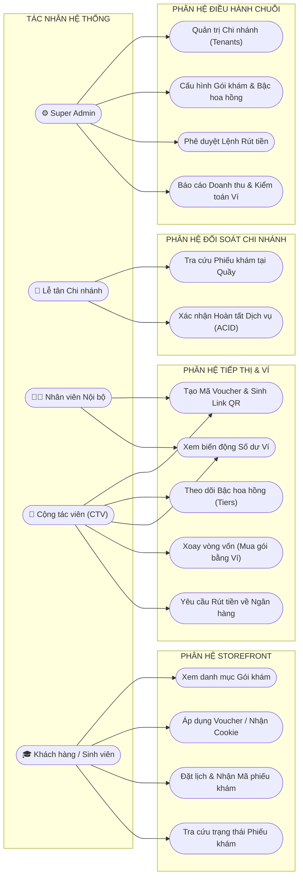
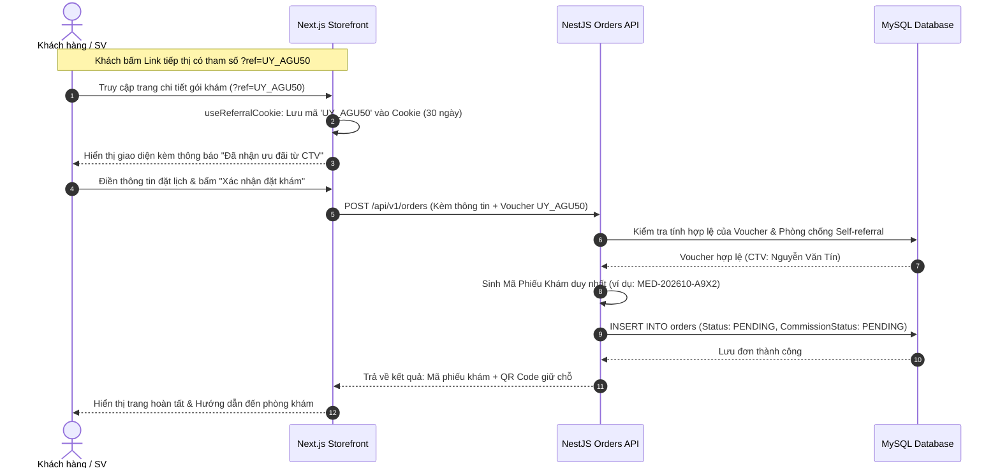
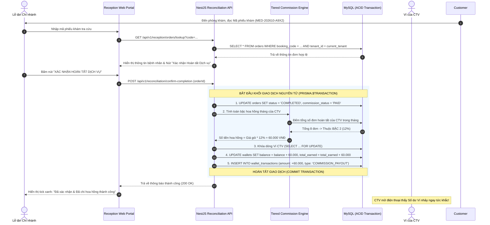
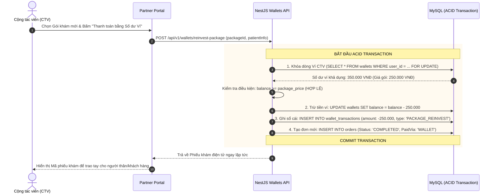
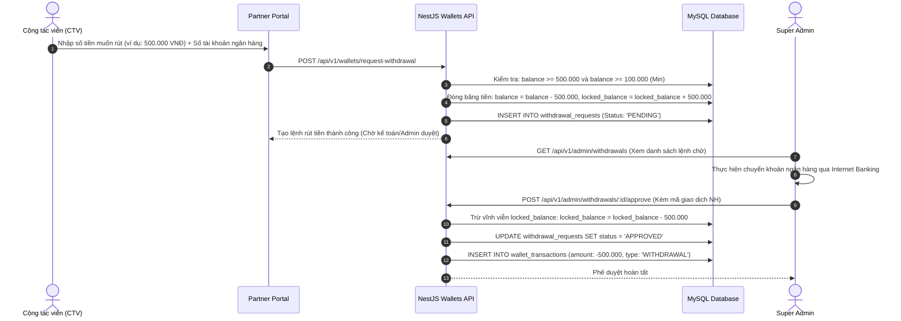

# 📙 DOC-03: SƠ ĐỒ HỆ THỐNG & BIỂU ĐỒ TUẦN TỰ (SEQUENCE DIAGRAMS)

> **Dự án:** MedAffiliate SaaS Platform  
> **Chuẩn mô hình hóa:** UML & Mermaid Diagrams (Tương thích hiển thị 100% trên GitHub)  

---

## 1. SƠ ĐỒ USE CASE TỔNG QUAN (5 TÁC NHÂN)

Biểu đồ mô tả quyền hạn và các ca sử dụng chính của 5 tác nhân trong hệ sinh thái:

---

## 2. BIỂU ĐỒ TUẦN TỰ 1: ĐẶT LỊCH KHÁM & TẠM TÍNH HOA HỒNG

Mô tả luồng tương tác khi khách hàng quét QR / bấm Link tiếp thị của CTV và đặt gói khám:

---

## 3. BIỂU ĐỒ TUẦN TỰ 2: ĐỐI SOÁT LỄ TÂN & NỔ HOA HỒNG (ACID TRANSACTION)

Đây là **trọng tâm nghiệp vụ cốt lõi nhất** của dự án. Đảm bảo hoa hồng giải ngân tức thì nhưng an toàn 100%:

---

## 4. BIỂU ĐỒ TUẦN TỰ 3: XOAY VÒNG DÒNG TIỀN (MUA GÓI BẰNG VÍ)

Mô tả tính năng độc đáo: CTV dùng chính số dư hoa hồng để mua trực tiếp gói khám:

---

## 5. BIỂU ĐỒ TUẦN TỰ 4: YÊU CẦU RÚT TIỀN VỀ NGÂN HÀNG & ADMIN PHÊ DUYỆT

Mô tả quy trình kiểm soát dòng tiền và giải ngân thù lao:

